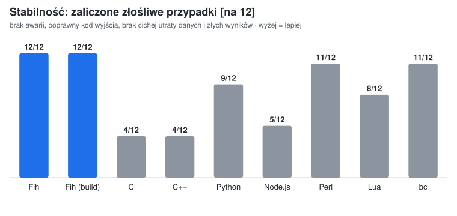
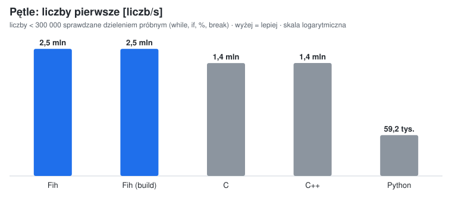
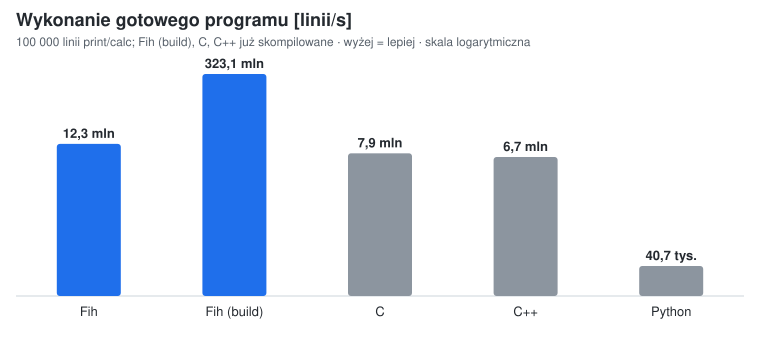
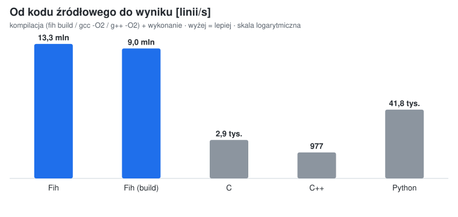
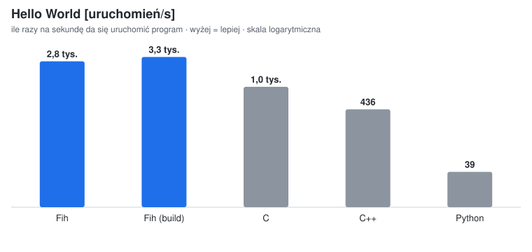
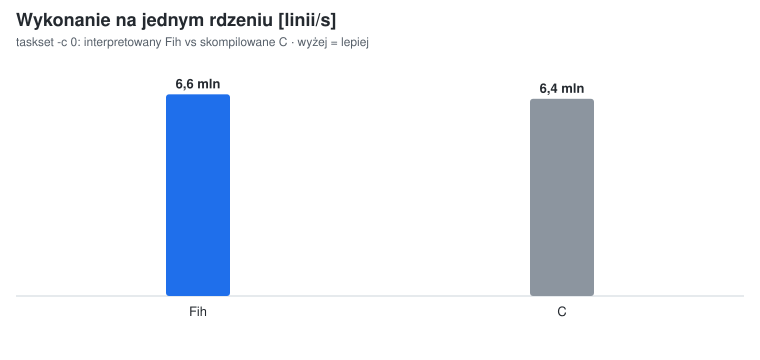
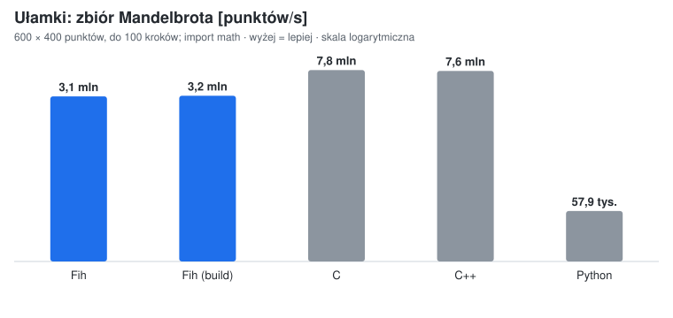
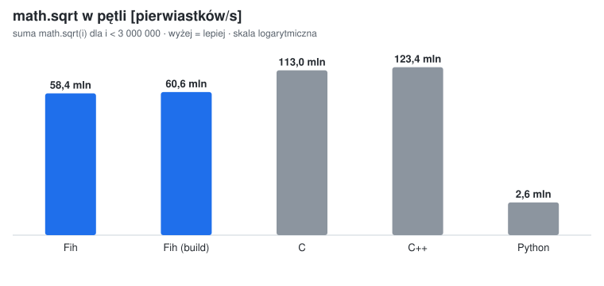

# Fih 🐟

[](https://github.com/vSake-clean/Fih/actions/workflows/ci.yml)

🇵🇱 [Polski](README.md) · 🇬🇧 English

A small programming language whose compiler is written in pure x86-64 assembly
(NASM), with no libc — just Linux syscalls. Programs are translated to machine
code and either run straight from memory (JIT) or written out as a standalone
ELF executable.

```
# FizzBuzz in Fih
i = 1
while i <= 15 {
    if i % 15 == 0 {
        print("FizzBuzz")
    } else if i % 3 == 0 {
        print("Fizz")
    } else if i % 5 == 0 {
        print("Buzz")
    } else {
        calc(i)
    }
    i += 1
}
```

**Fih 0.3** has integer variables, `if`/`else if`/`else`, `while` loops,
`break`/`continue`, comparisons (including chains like `0 < x < 10`),
`and`/`or`/`not`, output (`print`, `write`, `calc`) and reading numbers and
characters (`input()`, `inputchar()`). It does not have functions, arrays or
string variables yet ([ROADMAP.md](ROADMAP.md)).

An interactive example — a calculator
([examples/kalkulator.fh](examples/kalkulator.fh); its messages are in Polish):

```
$ fih examples/kalkulator.fh
Kalkulator Fih
Działania: + - * / %   (q zamiast działania kończy)

Podaj pierwszą liczbę: 6
Działanie (+ - * / %): *
Podaj drugą liczbę: 7
Wynik: 42

Podaj pierwszą liczbę: abc
To nie jest liczba, spróbuj jeszcze raz (koniec: Ctrl+D).
Podaj pierwszą liczbę: 1
Działanie (+ - * / %): /
Podaj drugą liczbę: 0
Nie można dzielić przez zero.
```

| Document | Contents |
|---|---|
| [SPEC.md](SPEC.md) | full language specification: grammar, semantics, errors, limits (Polish) |
| [ROADMAP.md](ROADMAP.md) | plan for upcoming versions (Polish) |
| [CHANGELOG.md](CHANGELOG.md) | changes in each version (Polish) |
| [CONTRIBUTING.md](CONTRIBUTING.md) | reporting bugs, tests, code style, versioning (Polish) |

## Installation

A prebuilt binary (Linux x86-64) is available in the [releases](https://github.com/vSake-clean/Fih/releases/latest):

```sh
curl -LO https://github.com/vSake-clean/Fih/releases/latest/download/fih-linux-x86_64
chmod +x fih-linux-x86_64 && sudo mv fih-linux-x86_64 /usr/local/bin/fih
fih --version
```

## Building

Requirements: Linux x86-64, NASM 2.15+, GNU ld.

```sh
sudo apt install nasm
make            # builds ./fih
make test       # tests (both modes, edge cases)
make fuzz       # random programs compared against a reference implementation (tests/fuzz/oracle.py)
make bench      # benchmark vs C, C++, Python (needs gcc, g++, python3, hyperfine)
                # FULL=1 make bench also re-measures C/C++ compilation (~10 min)
make charts     # SVG charts in docs/ from the bench/*.csv results
```

## Usage

```sh
./fih program.fh                    # run: compile in memory (JIT) and start
./fih build program.fh              # compile: creates the executable ./program
./fih build program.fh -o name      # ... with a chosen name
./fih --help                        # usage
./fih --version                     # version
```

The whole file is checked before it runs: on a syntax error the program prints
nothing, and `build` does not create a file. Runtime errors (division by zero,
overflow) are reported by the running program — after it has printed whatever
it computed so far. Both modes produce identical output, messages and exit
codes.

`fih build` creates a static x86-64 ELF file with no libraries that runs
without Fih. Programs that contain only `print` and `calc` with constants are
evaluated right away (build writes out the finished result), and large ones
(512 KB and up) are evaluated on all CPU cores.

A program can also be piped in: `echo 'calc(6*7)' | ./fih /dev/stdin`.

## The language (version 0.3)

The full specification (grammar, semantics, every error, limits) is in
[SPEC.md](SPEC.md). That file is meant to be readable by an AI model, too.

One statement per line, comments run from `#` to the end of the line.

| Statement | Effect |
|---|---|
| `print("...")` | prints a string and a newline; escapes `\n` `\t` `\\` `\"` |
| `write("...")`, `write(expression)` | like `print`/`calc`, but without the newline |
| `calc(expression)` | prints the value of an expression (also `calc("expression")`, as in 0.1) |
| `x = expression` | assignment; also `+=` `-=` `*=` `//=` `%=` (`/=` with `import math`) |
| `if e {` … `} else if e {` … `} else {` … `}` | conditional (true = non-zero) |
| `while e {` … `}` | loop; `break` and `continue` |
| `input()`, `inputchar()` | (in an expression) a number / character code from the input line; `inputok()`, `eof()` |

Expressions: 64-bit integers, variables, `+ - * // %`, parentheses, unary `-`,
comparisons `== != < <= > >=` (result 1 or 0, chained as in Python:
`0 < x < 10`), `and`, `or`, `not` (short-circuiting), character literals
`'+'` (the character code).
`//` truncates toward zero, `%` takes the sign of the dividend (as in C).
Overflow (e.g. `9223372036854775807 + 1`) and division by zero are errors with a
line number, never a silently wrong number:

```
fih: błąd w linii 2: dzielenie przez zero
```

(“error on line 2: division by zero” — Fih's messages are in Polish.)

With `import math` you also get fractions (`2.5`, `7 / 2` = 3.5, printed the
way Python prints them) and the functions `math.sqrt`, `math.sin`,
`math.floor`, `math.round`, `math.pow`, `math.random`, `math.pi`... (full list
in [SPEC.md](SPEC.md)):

```
import math
r = 2.5
print("pole koła: " + math.pi * r * r)    # pole koła: 19.634954084936208
print(math.floor(7 / 2))                  # 3
```

Using a variable before it is assigned is an error: `nieznana zmienna 'x'`
(“unknown variable”, reported before the program runs) or
`zmienna 'x' nie ma jeszcze wartości` (“variable has no value yet”, when the
assignment did not execute).

## Robustness

Fih should never crash. Every situation ends with a `fih: błąd...` message and
exit code 1:

- errors in the program (with a line number), including division by zero,
  overflow, a number too large in the source and a variable with no value;
- very deep parentheses: the limit adapts to `ulimit -s`; 65,536 variables
  and 65,536 nested blocks;
- the source file being truncated while it runs (`SIGBUS` is handled);
- a full disk, `/dev/full`, a closed pipe; with `build` an incomplete output
  file is removed;
- out of memory or a process limit: multi-core mode then falls back to
  sequential execution.

This is checked by `make test` (295 tests, programs run in both modes) and
`make fuzz`:

- `tests/fuzz/oracle.py`: an independent implementation of Fih in Python (the oracle);
- `tests/fuzz/fuzz2.py`: random 0.2 programs (variables, `if`, `while`, `break`,
  comparison chains, errors) compared with the oracle: output, error message,
  line number and exit code, in both modes;
- `tests/fuzz/fuzz.py`: the same for `print`/`calc` programs;
- `tests/fuzz/par_fuzz.py`: the same for large programs split across cores;
- `tests/fuzz/gcc_oracle.py`: expressions compiled by gcc (`-fwrapv`) as a second,
  independent arithmetic oracle;
- `tests/fuzz/crash_fuzz.py`: random bytes and mutations without an oracle; only
  exit codes 0 and 1 are allowed, never a signal;
- `tests/truncate.sh`: a file truncated while it runs.

`make stability` (`bench/stability.py`) runs the same hostile cases against 9
implementations. A case passes when there is no crash (signal, compiler crash,
hang), an error gives a non-zero exit code, no data is silently lost, and an
arithmetic result is either exact or reported as an error:



## Performance

Measured on a Celeron 1005M (2 cores), higher is better. On integers Fih is
faster than C (gcc -O2) in every measurement; on fractions it is 2–2.5× slower
than C and more than 20× faster than Python.

**Loops** — primes below 300,000 checked by trial division
(`while`, `if`, `%`, `break`), the same algorithm in every language
(`bench/primes/`):



**A `print`/`calc` program** — 100,000 lines of constant expressions:






**Fractions** (`import math`) — a 600 × 400 Mandelbrot set, up to 100 steps
(`bench/floats/mandel.*`), and the sum of `math.sqrt(i)` for i < 3,000,000
(`bench/floats/sqrt.*`):




| | Fih | Fih (build) | C (gcc -O2) | C++ (g++ -O2) | Python 3.13 |
|---|---|---|---|---|---|
| loops, numbers/s | **2.5 M** | **2.5 M** | 1.4 M | 1.4 M | 59 k |
| print/calc program, lines/s | **13.3 M** (2 cores) | **367 M** | 8.3 M | 6.9 M | 42 k |
| the same on 1 core, lines/s | **8.0 M** | | 7.7 M | | |
| source to result, lines/s | **13.3 M** | 9.0 M | 2.9 k | 977 | 42 k |
| Hello World, runs/s | 3.1 k | **3.7 k** | 1.2 k | 495 | 40 |
| Mandelbrot, points/s | 3.1 M | 3.2 M | **7.8 M** | 7.6 M | 58 k |
| math.sqrt, roots/s | 58 M | 61 M | 113 M | **123 M** | 2.6 M |

In loops Fih is 1.9× faster than C and 43× faster than Python.
The compiler turns division by a constant into multiplication, comparisons in
conditions into single jumps, and performs division by a variable with a 32-bit
instruction when both numbers fit in 32 bits (2–3× faster than the 64-bit one
gcc uses). “Fih” (without build) includes the in-memory compilation in every
run.

`print`/`calc` programs with constants are evaluated by a hand-optimized
interpreter: SSE2 string scanning, SWAR number parsing (8 digits at a time),
printing numbers 2 digits at a time without division, single-pass expressions,
a branch-free common path, and large programs spread over all cores.
`fih build` evaluates such a program at compile time, so the executable only
prints the finished result.

Fractions use SSE2 instructions (addition, multiplication, square root), and
transcendental functions use the x87 coprocessor. C wins here because it keeps
variables in CPU registers; Fih keeps them in memory (planned for later,
[ROADMAP.md](ROADMAP.md)).

## Layout

```
src/main.asm    program start, reading the file, choosing the engine
src/comp.asm    the 0.2 compiler: parser, x86-64 code generator, JIT, ELF writer
src/rt.asm      runtime for compiled programs (output, errors,
                fractions: rt_flt.inc, rt_dec.inc; math functions: rt_math.inc)
src/imp.asm     imports and permissions (Landlock, limits, seccomp)
src/interp.asm  fast interpreter for print/calc programs
src/expr.asm    parser and evaluator of constant expressions for calc
src/io.asm      output (stdout or memory), numbers, errors
src/elf.asm     writing the finished result as an ELF file
src/par.asm     running large print/calc programs on multiple cores
tests/          tests/ok (expected stdout), tests/err (expected errors),
                tests/fuzz (oracle and fuzzers), tests/*.py
bench/          test program generator, benchmark, charts (charts.py)
docs/           SVG bar charts
```

## License

[MIT](LICENSE) © 2026 vSake. You may use, modify and distribute Fih freely,
including commercially, as long as the copyright notice and the license text
are kept.

---

## More projects by vSake

- **[Szept](https://github.com/vSake-clean/Szept)** — serverless Android messenger
- **[LunarDraw](https://github.com/vSake-clean/LunarDraw)** — GTK3/Cairo drawing app with layers
- **[LuminaView](https://github.com/vSake-clean/LuminaView)** — fast, lightweight Qt5 image viewer for Linux
- **[StatusCycler](https://github.com/vSake-clean/StatusCycler)** — Vencord plugin that cycles your Discord custom status
- **[vencord-AutoReply](https://github.com/vSake-clean/vencord-AutoReply)** — Vencord plugin for automatic replies with triggers and filters
- **[vencord-StickyNotes](https://github.com/vSake-clean/vencord-StickyNotes)** — Vencord plugin for sticky notes on Discord users
- **[vencord-friendgroups](https://github.com/vSake-clean/vencord-friendgroups)** — Vencord plugin to group friends in the DM sidebar

If you like this project, consider leaving a ⭐ — it really helps!
